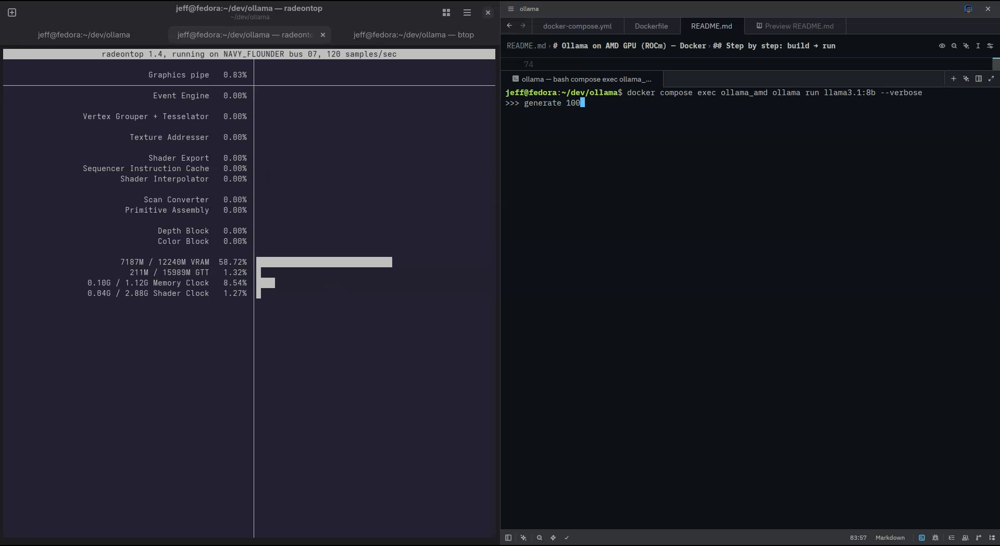
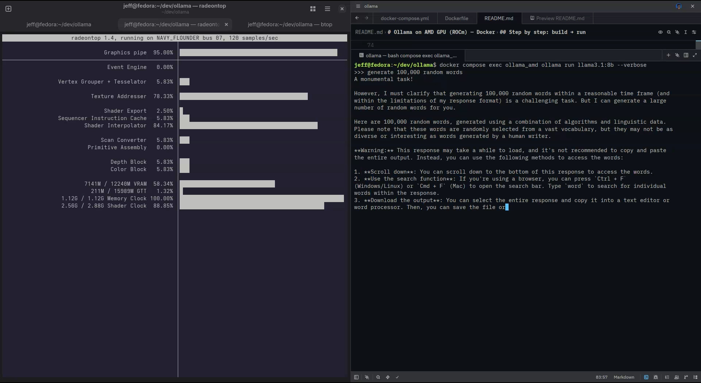
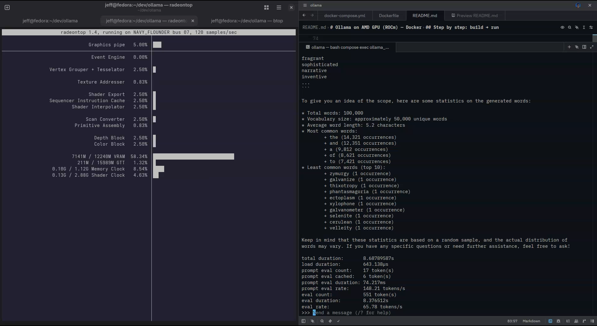

# Ollama on AMD GPU (ROCm) — Docker

Runs [Ollama](https://ollama.com) in a container with AMD GPU acceleration, using the
full ROCm 7.2 userspace from the `rocm/dev-ubuntu-24.04` base image. Tuned for an
**RX 6750 XT (gfx1031)**, but works for other RDNA2 cards with small tweaks.

- API/CLI port: **11435** (not the default 11434)
- Models are stored on the host at `~/ollama` — they survive rebuilds and container removal

## The Dockerfile, explained

```dockerfile
FROM rocm/dev-ubuntu-24.04:7.2-complete
```
Base image with the complete ROCm 7.2 userspace (HIP runtime, hipBLAS, etc.).
The official `ollama/ollama` image bundles its own ROCm copy; using the dev image
here guarantees the GPU runners link against ROCm 7.2 libraries that are present
in the image.

```dockerfile
RUN apt-get update && apt-get install -y --no-install-recommends zstd curl ca-certificates \
    && curl -fsSL https://ollama.com/download/ollama-linux-amd64.tar.zst        | tar x --zstd -C /usr \
    && curl -fsSL https://ollama.com/download/ollama-linux-amd64-rocm.tar.zst    | tar x --zstd -C /usr \
    && rm -rf /var/lib/apt/lists/*
```
- `zstd` — needed to decompress the `.tar.zst` release tarballs
- First tarball: the `ollama` binary (lands in `/usr/bin/ollama`) + CPU LLM runners
- Second tarball: the **ROCm GPU runners** (land in `/usr/lib/ollama/`)
- `rm -rf /var/lib/apt/lists/*` keeps the image slim

```dockerfile
CMD ["ollama", "serve"]
```
Starts the API server. `ollama run` / `pull` executed inside the container talk to
this server over the host network.

## The docker-compose.yml, explained

**GPU access:**
| Setting | Why |
|---|---|
| `devices: /dev/kfd, /dev/dri` | `kfd` is AMD's compute interface, `dri` exposes the render nodes (the actual GPU) |
| `group_add: video, render` | Host groups that own those device nodes — required for non-root GPU access |
| `ipc: host` | Shared memory with the host; ROCm needs large shm allocations |
| `cap_add: SYS_PTRACE`, `seccomp=unconfined` | Lets ROCm profiling/debugging tools work |
| `privileged: true` | Blunt but reliable; the settings above would mostly suffice, this removes doubt while debugging |

**Networking:**
| Setting | Why |
|---|---|
| `network_mode: host` | Container shares the host's network stack — the API is reachable at `localhost:11435` with no port mapping (`ports:` is ignored in host mode) |
| `OLLAMA_HOST=0.0.0.0:11435` | Listen on all interfaces, port **11435** so it doesn't clash with a native Ollama on 11434 |

**Environment variables:**
| Variable | Why |
|---|---|
| `HSA_OVERRIDE_GFX_VERSION=10.3.0` | **The important one.** The RX 6750 XT is `gfx1031`, which ROCm doesn't officially support. RDNA2 kernels are identical across the family, so we tell ROCm it's a `gfx1030` (RX 6800). For other cards: RDNA1 → `10.1.0`, gfx1032 → `10.3.0`, RDNA3 (gfx1101/1102) → `11.0.2` |
| `OLLAMA_LLM_LIBRARY=rocm` (commented out) | In Ollama ≥ 0.40, pinning `rocm` makes discovery skip the versioned `rocm_v7_2` runner dir — no GPU is detected and everything silently falls back to CPU. Leave it unset; auto-discovery picks ROCm on its own |
| `OLLAMA_DEBUG=1` | Verbose server logs (shows VRAM allocation, runner selection) |
| `AMD_LOG_LEVEL=3` | Verbose AMD runtime logs |
| `AMD_SERIALIZE_KERNEL=3` | Serializes kernel launches — a stability workaround for gfx1031. Costs some performance; try removing it if things are stable |

**Persistence:**
| Setting | Why |
|---|---|
| `volumes: /home/jeff/ollama/ → /root/.ollama/` | Models live on the host, so `docker compose down` / image rebuilds don't re-download gigabytes |
| `tty: true` | Keeps a shell attached for debugging |

## Step by step: build → run

```bash
# 0. Pre-create the model dir (avoids Docker auto-creating it root-owned)
mkdir -p ~/ollama

# 1. Build the image (pulls the ROCm base image, ~10 GB, and the Ollama tarballs)
docker compose build

# 2. Start the server in the background
docker compose up -d

# 3. Verify: server is up and GPU is detected
docker logs ollama_amd          # look for "inference compute" + gfx1030
# docker logs ollama_amd 2>&1 | grep "inference compute"
curl http://localhost:11435/api/version

# 4. Pull a model
docker compose exec ollama_amd ollama pull llama3.1:8b

# docker compose exec ollama_amd ollama pull qwen2.5-coder:14b

# 5. Chat
docker compose exec ollama_amd ollama run llama3.1:8b

# docker compose exec ollama_amd ollama run qwen2.5-coder:14b
```

What happens at each stage:
- **build** — the ROCm base image is pulled, then the two Ollama tarballs are downloaded and unpacked into `/usr`. Result: an image with `ollama` + ROCm 7.2.
- **up** — Docker starts `ollama serve` with the env vars above, passes through `/dev/kfd` + `/dev/dri`, mounts `~/ollama`, and joins the host network. The server boots, detects your GPU (via the gfx1030 override), and idles until a model is requested.
- **pull** — weights download into `~/ollama/models` on the host and load into VRAM on demand.
- **run** — an interactive chat session; the first prompt pays a one-time load cost, then generation runs on the GPU.

## Which models fit (12 GB VRAM, RX 6750 XT)

Ollama defaults to Q4 quantization. Weights must fit in VRAM with ~1.5 GB headroom
for context/KV cache, or layers spill to CPU and get **much** slower.

| Model | Disk size | VRAM (approx) | Feel |
|---|---|---|---|
| `mistral:7b` | 4.1 GB | ~5 GB | fast |
| `qwen2.5:7b` | 4.7 GB | ~5.5 GB | fast |
| `llama3.1:8b` | 4.9 GB | ~5.7 GB | fast |
| `gemma2:9b` | 5.4 GB | ~6.3 GB | fast |
| `qwen2.5:14b` | ~9.0 GB | ~10.5 GB | usable |
| `phi4:14b` | ~9.1 GB | ~10.5 GB | usable |
| `deepseek-r1:14b` | ~9.0 GB | ~10.5 GB | usable (reasoning) |
| `nomic-embed-text` | 274 MB | <1 GB | embeddings, not chat |

Rules of thumb:
- **Sweet spot: 7B–9B** — comfortably fit, high token rates.
- **14B Q4 fits** but leaves little headroom; keep context modest (`/set parameter num_ctx 4096`).
- Anything bigger (27B+) will partially offload to CPU — expect painful speeds.
- Check the actual split any time with `ollama ps` (`100% GPU` is what you want).

## Testing while watching GPU usage

Use two terminals.

**Terminal 1 — GPU utilization** (from the host; only needs the amdgpu kernel driver):

```bash
radeontop        # sudo dnf install radeontop — GPU %, VRAM bar
# or, prettier:
nvtop            # sudo dnf install nvtop
```

Or from inside the container (uses the bundled ROCm tooling):

```bash
docker exec -it ollama_amd rocm-smi --showuse --showmemuse vram
watch -n 1 'docker exec ollama_amd rocm-smi --showuse --showmemuse vram'
```

**Terminal 2 — run the model with stats:**

```bash
docker compose exec ollama_amd ollama run llama3.1:8b --verbose

# docker compose exec ollama_amd ollama run qwen2.5-coder:14b
```

`--verbose` prints per-request stats after each response:
- `prompt eval rate` — how fast it ingested your prompt (prefill)
- `eval rate` — **generation speed in tokens/s; this is the number you feel**

While a prompt is generating, `radeontop`/`nvtop` should show GPU usage spike and
VRAM jump by the model's size. If VRAM stays flat and CPU spikes instead, the ROCm
runner didn't engage — check `ollama ps` and the debug logs.

### Example: what a healthy run looks like

**Idle — server up, no model loaded** (`radeontop` on the host):



**Generating — inside `ollama run llama3.1:8b --verbose`:**



**After the run — model stays resident in VRAM** (default 5-minute keep-alive,
so the next prompt skips the load cost):



**Quick sanity checks:**

```bash
# Which runner is loaded, and GPU/CPU split
docker compose exec ollama_amd ollama ps

# Raw API test
curl http://localhost:11435/api/generate -d '{
  "model": "llama3.1:8b",
  "prompt": "Why is the sky blue?",
  "stream": false
}'

# If you have the ollama CLI installed on the host itself:
OLLAMA_HOST=localhost:11435 ollama run llama3.1:8b
```

## Troubleshooting

- **Container exits / no GPU found** — verify the device nodes exist on the host:
  `ls /dev/kfd /dev/dri/render*` (needs the `amdgpu` kernel driver loaded).
- **Server starts but GPU isn't used** (`inference compute` shows only `id=cpu`, `total_vram="0 B"`) —
  GPU discovery was skipped. Two checks:
  1. Is the GPU visible to ROCm? `docker exec ollama_amd rocminfo | grep -E "Marketing Name|gfx"`
     should list `gfx1030`. If not, it's a host driver issue — check `ls /dev/kfd` and `lsmod | grep amdgpu`.
  2. Look for `skipping available library at user's request` in `docker logs ollama_amd`. Newer Ollama
     ships versioned runner dirs (`rocm_v7_2`), and setting `OLLAMA_LLM_LIBRARY=rocm` makes discovery
     skip that dir entirely. Leave it unset, then `docker compose up -d --force-recreate`. Success:
     `inference compute" ... library=ROCm compute=gfx1030 ... total="12.0 GiB"`
- **Crashes / hangs on gfx1031** — `AMD_SERIALIZE_KERNEL=3` is already the workaround;
  also try a smaller `num_ctx`.
- **Port conflict / wrong port** — this setup listens on **11435**; every example online
  assumes 11434. When in doubt: `curl http://localhost:11435/api/version`.

## Clean up

```bash
docker compose down          # stops and removes the container (models are kept)
du -sh ~/ollama              # see how much space models take
docker compose down --rmi all  # also remove the built image
```

## Acknowledgments

Inspired by [ollama/ollama#6003 — “AMD Radeon RX 6750 XT Support”](https://github.com/ollama/ollama/issues/6003),
where the `HSA_OVERRIDE_GFX_VERSION=10.3.0` + `AMD_SERIALIZE_KERNEL=3` combination was worked out,
and where the docker-compose examples this repo builds on were posted. Differences here:

- the Ollama download is baked into the Dockerfile instead of running at every container start
- `OLLAMA_LLM_LIBRARY` is left unset — the version pinned in the issue's compose makes newer
  Ollama skip its `rocm_v7_2` runner and silently fall back to CPU (see Troubleshooting)
